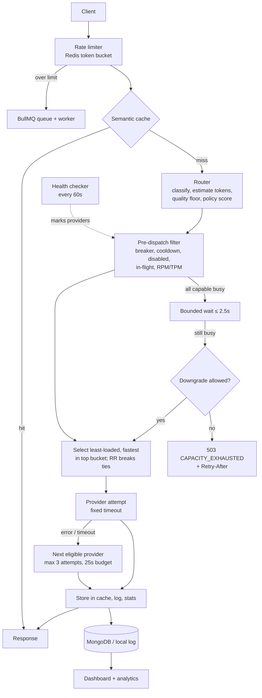

# CortexGate

**A self-hosted, LiteLLM-style AI gateway: one OpenAI-compatible endpoint in front of many LLM providers, with smart routing, bounded failover, semantic caching and a live analytics console.**

> **Status (Nov 26, 2026): feature-complete prototype.** Smart quality/cost/token/load-aware routing, capacity-aware failover, active health checks, 15 provider adapters plus user-defined OpenAI-compatible providers, encrypted dashboard-managed API keys, client API keys with per-key limits and budgets, semantic cache with per-type TTLs, analytics API, a multi-page dashboard, a Docker deployment and the `cortexgate` CLI are implemented and covered by 171 automated tests (132 gateway, 39 CLI). See [PROGRESS_LOG.md](PROGRESS_LOG.md) for the dated project record and [PROJECT_SCOPE.md](PROJECT_SCOPE.md) for scope.

*Major Project (PR1107), Institute of Engineering and Technology (IET), JK Lakshmipat University.*

## Why CortexGate

Applications that call LLM APIs run into three recurring problems:

1. **Rising token costs.** The same question in different words is billed in full every time; exact-match caching cannot detect rewordings, and simple prompts are often sent to expensive models.
2. **Poor load handling.** One key on one provider returns HTTP 429 or times out under load, and the application shows a hard error.
3. **No visibility or control.** Teams cannot see what was spent, which provider is degraded, or why a request went where it did.

CortexGate puts routing, caching, failover, quota control and cost accounting in one place between the application and the providers.

## Features

| Feature | Status |
|---|---|
| OpenAI-compatible `POST /v1/chat/completions` and `GET /v1/models` | Implemented |
| Provider adapters: Groq, Gemini, NVIDIA NIM, OpenRouter, Cerebras, Cloudflare Workers AI, Cohere, Together, Mistral, SambaNova, GitHub Models, Hugging Face, Ollama (local), LM Studio (local) | Implemented |
| User-defined OpenAI-compatible providers (Together, Fireworks, DeepInfra, vLLM, …) added from the dashboard | Implemented |
| Encrypted (AES-256-GCM) dashboard-managed API keys, never returned to the browser | Implemented |
| Smart routing: request classification, token estimation, quality floors, cost/balanced/quality policies | Implemented |
| Load- and quota-aware dispatch (in-flight caps, per-provider RPM/TPM budgets, cooldowns) | Implemented |
| Bounded capacity queue, explicit quality-downgrade rules, clear `503 CAPACITY_EXHAUSTED` | Implemented |
| Bounded failover: fixed per-attempt timeout, max attempts, request budget, circuit breaker | Implemented |
| Persisted provider health (bad keys / billing / broken endpoints are not retried after restart) | Implemented |
| Active background health checks | Implemented |
| Semantic cache: embeddings + cosine similarity, model verification of borderline matches | Implemented |
| Cache guards: time-sensitive bypass, negation and number guards; per-type TTLs, LRU, sweep | Implemented |
| Full cost accounting: chat, verification and embedding costs; gross and net savings | Implemented |
| Analytics API: time series, latency percentiles, error types, failover chains, per-model costs | Implemented |
| Multi-page dashboard: overview, analytics, providers, routing, logs, playground, settings | Implemented |
| Gateway rate limiting (Redis token bucket) with BullMQ request queue and worker | Implemented |
| MongoDB request logging, local JSON fallback, WebSocket live metrics | Implemented |
| Client API keys (`cg-…`): hashed storage, per-key RPM/TPM, budgets, expiry, provider/policy restrictions, usage tracking | Implemented |
| Auth modes (`auto` / `required` / `off`) and admin token for monitoring and key management | Implemented |
| Docker deployment: gateway + worker + Redis + Ollama (+ optional MongoDB), restarts automatically | Implemented |
| `cortexgate` CLI: init, start/stop/status/logs, keys, test, doctor (Docker or background Node mode) | Implemented |
| Vector database for the cache (Qdrant / pgvector) | Future option |
| Multi-user dashboard accounts, alerts | Stretch scope |

## Architecture



## How routing works

Every request (unless it names a provider or model explicitly) goes through these steps. Each decision is recorded in the response (`routing`, `attempts`) and on the dashboard.

1. **Estimate.** Input tokens ≈ characters ÷ 4. The classifier detects the task (factual, chat, summarize, code, creative, reasoning) and estimates output tokens (≈150 for a factual answer, ≈700 for code, ≈900 for reasoning; ×1.6 for "detailed / step by step", ×0.3 for "briefly"). A complexity score maps the request to a tier with a **minimum model quality**: light 0.40, standard 0.60, heavy 0.80. Prompt length is only one signal, so a long but simple prompt is not sent to an expensive model.
2. **Eligible models.** A provider's model qualifies only if its quality meets the floor and its context window fits input + estimated output. Expected cost = input × prompt price + output × completion price.
3. **Pre-dispatch filtering (load and quota, not just health).** Providers are removed if disabled (bad key, billing, broken endpoint), circuit-open, in a 429 cooldown, at their in-flight cap, or out of their rolling 60-second RPM/TPM budget (defaults follow each free tier, e.g. Groq 30 RPM / 8 000 TPM, Gemini 10 RPM). Each exclusion is logged with its reason.
4. **Score by policy.**
   - `cost`: cheapest eligible model.
   - `quality`: highest-quality eligible model.
   - `balanced` (default): `0.40·quality + 0.25·(1 − normalized cost) + 0.35·speed` (light requests weight speed more). Speed uses measured median latency × reliability.
   - Every score is multiplied by `1 − 0.5·load`, where load is the highest of in-flight, RPM and TPM usage, so one provider is not overcrowded.
5. **Select.** Candidates within 0.12 of the best score form the top bucket; the least-loaded, fastest one goes first, and round robin only breaks ties.
6. **Capacity wait.** If every capable provider is busy, the request waits in a per-provider FIFO for at most 2.5 seconds (queue max 20). A provider's `Retry-After` is honored only if it fits in that wait.
7. **Downgrade rules.** If the wait expires, the request moves down one tier only when the policy allows it (allowed for `cost` and `balanced`, never for `quality`; override with `x-allow-downgrade`). Downgrades are logged with the reason. Otherwise the gateway returns `503 CAPACITY_EXHAUSTED` with `Retry-After`. A complex request is never silently sent to a weak model.

### Failover

Round robin over every provider makes failover slow; always choosing the healthiest provider overcrowds it. CortexGate combines them:

- **Health-first ranking**, with round robin only among near-equal healthy providers.
- **Bounded failover:** 10 s fixed timeout per attempt (`PROVIDER_TIMEOUT_MS`; Ollama 30 s), at most 3 attempts (`MAX_FAILOVER_ATTEMPTS`), 25 s overall (`REQUEST_BUDGET_MS`). The next attempt goes to the next eligible provider of the required quality.
- **Error handling:** 429 → cooldown for `Retry-After` (or 30 s); 401/403/402 → provider disabled for 1 h; non-JSON response → disabled for 30 min; 3 consecutive failures → circuit open for 20 s, then a single probe.
- **Persistence:** provider health is saved to `data/provider-health.json` and fingerprinted by API key, so a restart does not retry known-broken providers, and changing a key re-enables the provider.
- **Active health checks** every 60 s use free `GET /models`-style endpoints; a tiny chat probe runs only for providers whose circuit is open.

Measured on Nov 26, 2026: a heavy request that previously tried five providers in 28 s now completes on the first eligible provider in about 6.7 s, with broken providers excluded before dispatch.

## Semantic cache

1. The last user message is embedded with Gemini `gemini-embedding-001` (`SEMANTIC_SIMILARITY` task type). Identical prompts reuse an in-memory embedding memo, so repeats make no embedding call.
2. Cosine similarity `a·b / (|a||b|)` is computed against entries under the same system prompt.
3. Decision order: below `CACHE_THRESHOLD` (0.92) → miss; different numbers in the two questions → miss; similarity ≥ `CACHE_TRUST_ABOVE` (0.985) and no negation mismatch → hit; otherwise one cheap light-tier model check (YES → hit, NO or error → miss).
4. Time-sensitive prompts (today, latest, news, weather, prices, scores) are neither served from nor stored in the cache. Only single-turn prompts are cached.
5. **TTL by question type** (fixed when stored; hits never extend it): factual 7 days, code 3 days, general 24 hours, creative 6 hours. A background sweep removes expired entries every 10 minutes; at most 1 000 entries (LRU). Vectors are held as Float32 in memory and base64 on disk (~15 MB at the cap).

**Formulas.** `hitRate = hits / (hits + misses)` over cacheable lookups. `embedCost = Σ ceil(chars/4) × EMBED_PRICE_PER_1M / 10⁶`. `netSaved = costSaved − verifyCost − embedCost`.

### Threshold evaluation

`scripts/tune-threshold.mjs` embeds 8 paraphrase pairs and 8 different-meaning pairs. With `SEMANTIC_SIMILARITY`, paraphrases scored 0.942–0.992 and different questions 0.829–0.911.

| Threshold | Paraphrase hits | Wrong hits |
|---|---|---|
| 0.85 | 8/8 | 6/8 |
| 0.90 | 8/8 | 1/8 |
| **0.92** | **8/8** | **0/8** |
| 0.95 | 6/8 | 0/8 |

The model check blocked matches that embeddings alone accepted ("convert 10 miles to km" vs "convert 10 km to miles" at 0.981) while confirming real paraphrases.

### Gemini errors

The intermittent Gemini errors were not embedding rate limits (40 concurrent embedding calls all returned 200). Gemini chat models `gemini-3.8-flash` and `gemini-3.5-flash` frequently returned `503 high demand` or timed out, and one search could previously trigger up to four Gemini requests. Now a search makes at most one embedding call (none for repeats), cache verification uses a light model, Gemini falls back to `gemini-3.5-flash-lite` inside the same attempt, and the gateway fails over within the fixed timeout instead of surfacing the error.

## Dashboard

Open `http://localhost:3003/dashboard` (use `localhost` so key management is allowed). It receives live metrics over WebSocket (`/ws/metrics`, polling fallback) and analytics from `/v1/analytics`.

- **Overview:** KPI cards, traffic chart, provider share, recent failovers, provider health strip.
- **Analytics:** traffic by provider, p50/p95/p99 latency, cost vs savings, error types, per-provider and per-model tables, tier/task/policy usage, failover chains, cache funnel (15 min to 7 days).
- **Providers:** state, disable reason, health check results, RPM/TPM meters, queue depth, cooldowns, test button.
- **Routing:** how decisions are made, tier/task distribution, downgrades, capacity rejections.
- **Logs:** every request with its attempt chain, candidate scores and exclusions.
- **Playground:** send prompts with a policy, provider override, downgrade toggle and cache bypass.
- **Settings:** add or replace keys for built-in providers, and add custom OpenAI-compatible providers from presets.

Costs shown are **list-price estimates**, not provider invoices; free tiers may make the real bill zero.

## Getting started

### Prerequisites

- Node.js 18+ (tested on Node 24)
- Docker (for Redis and the optional local Ollama model)
- At least one provider key, e.g. Groq (https://console.groq.com/keys) or Gemini (https://aistudio.google.com/apikey). Gemini is also used for cache embeddings.

### Option 1: install with the CLI (recommended)

```bash
git clone https://github.com/Rakshikagarg/CortexGate.git
cd CortexGate
npm install -g ./cli          # installs the `cortexgate` command
cortexgate init               # asks for provider keys, generates ADMIN_TOKEN, encryption key and your first client key
cortexgate start              # runs in the background (Docker mode, or --node without Docker)
cortexgate status             # health, auth mode, provider summary
cortexgate open               # opens the dashboard
```

**You choose your providers.** CortexGate ships with adapters for 15 providers, but nothing is preconfigured: each installation adds only the API keys it has (during `cortexgate init`, in `.env`, or later on the dashboard under Keys & providers), plus any OpenAI-compatible endpoint as a custom provider. Providers without a key are never used, and routing adapts automatically to whatever is configured (with no key at all, the local Ollama model can still serve requests).

`init` merges into `services/gateway/.env` without overwriting existing values (a timestamped backup is made first) and prints the client key and admin token once. Other commands:

| Command | What it does |
|---|---|
| `cortexgate start [--docker\|--node]` / `stop` / `restart` | Run the gateway (and queue worker) in the background |
| `cortexgate status [--json]` | Health, uptime, auth mode, policy, Redis/Mongo, provider summary |
| `cortexgate logs [-f] [--worker]` | Gateway or worker logs |
| `cortexgate keys create <name> [--rpm N --tpm N --budget USD --expires ISO --providers a,b]` | Create a client key (shown once) |
| `cortexgate keys list` / `disable` / `enable` / `revoke <id\|name>` | Manage client keys |
| `cortexgate test "<prompt>" [--policy cost\|balanced\|quality] [--provider x]` | Send a request and show provider, model, tier, attempts, latency |
| `cortexgate doctor` | Check Node, Docker, ports, `.env`, Redis, Ollama, MongoDB, health |

See [cli/README.md](cli/README.md) for the full reference.

### Option 2: Docker Compose

```bash
cp services/gateway/.env.example services/gateway/.env   # add keys, ADMIN_TOKEN and CORTEXGATE_BOOTSTRAP_KEY
docker compose up -d                                     # gateway, worker, Redis, Ollama (restart automatically)
docker exec cortexgate_ollama ollama pull qwen2.5:0.5b   # optional local model
```

The gateway listens on `127.0.0.1:3003` by default (`CORTEXGATE_PORT`, `CORTEXGATE_BIND` change it), keeps its data in the `gateway_data` volume, and runs with `CLIENT_AUTH=required`. Requests from the host reach the container from the Docker bridge, so use a client key for API calls and `ADMIN_TOKEN` for the dashboard (enter it under Keys & providers → Admin access). After editing `.env`, run `docker compose up -d` again. Add `--profile mongo` for a local MongoDB. To put CortexGate online (VPS with TLS, Render, Railway, Fly.io), follow [docs/DEPLOY.md](docs/DEPLOY.md).

### Option 3: plain Node (development)

```bash
docker compose up -d redis ollama         # Redis (6380) and Ollama (11434)
cd services/gateway
npm install
cp .env.example .env                      # add your keys
npm start                                 # gateway on http://localhost:3003
npm run worker                            # optional: processes rate-limited (queued) requests
```

On Windows networks where Node cannot resolve MongoDB Atlas SRV records, set `DNS_SERVERS=8.8.8.8,1.1.1.1`.

## Client API keys

Applications authenticate with CortexGate keys, never with provider keys. Keys look like `cg-…`, are stored only as SHA-256 hashes (`data/client-keys.json`) and are shown once at creation.

```python
from openai import OpenAI
client = OpenAI(base_url="http://localhost:3003/v1", api_key="cg-...")
client.chat.completions.create(model="auto", messages=[{"role": "user", "content": "Hello"}])
```

`Authorization: Bearer cg-…` (OpenAI SDK default) and `x-api-key: cg-…` both work. Create keys with `cortexgate keys create`, on the dashboard (Keys & providers → API keys) or with `POST /v1/admin/keys`. Each key can have:

- `rpmLimit` / `tpmLimit`: per-key rolling 60 s limits (Redis-backed) → `429 KEY_RATE_LIMITED` with `Retry-After`
- `budgetUsd`: estimated spend cap (chat + verification + embedding cost) → `402 BUDGET_EXCEEDED`
- `expiresAt` → `403 KEY_EXPIRED`; `enabled: false` → `403 KEY_DISABLED`
- `allowedProviders` / `allowedPolicies` → `403 PROVIDER_NOT_ALLOWED` / `POLICY_NOT_ALLOWED`; failover never leaves the allowed set

Usage (requests, tokens, spend, errors, last used) is tracked per key and shown in Analytics. Missing or unknown keys get `401 INVALID_API_KEY`.

**Auth modes** (`CLIENT_AUTH`):

| Mode | Chat API | Monitoring (live stats, analytics, WebSocket) |
|---|---|---|
| `auto` (default for `npm start`) | key required except from localhost | localhost or `ADMIN_TOKEN` |
| `required` (default in Docker) | key always required | localhost or `ADMIN_TOKEN` |
| `off` | open (startup warning) | open |

Key and provider management (`/v1/admin/*`) is allowed from localhost while `ADMIN_TOKEN` is unset, and only with the token once it is set. `CORTEXGATE_BOOTSTRAP_KEY` imports a first key at startup (used by `cortexgate init` and Docker).

### Try it

```bash
# Routed automatically (light tier → fast cheap model)
curl -s localhost:3003/v1/chat/completions -H "Content-Type: application/json" \
  -d '{"messages":[{"role":"user","content":"What is the capital of France?"}]}'

# Reworded question → served from cache ("provider": "cache")
curl -s localhost:3003/v1/chat/completions -H "Content-Type: application/json" \
  -d '{"messages":[{"role":"user","content":"Which city is the capital of France?"}]}'

# Heavy reasoning with the quality policy (never downgraded)
curl -s localhost:3003/v1/chat/completions -H "Content-Type: application/json" \
  -H "x-routing-policy: quality" -H "x-cache: bypass" \
  -d '{"messages":[{"role":"user","content":"Prove step by step that there are infinitely many primes."}]}'
```

### Live demo guide

**Failover by stopping a provider** (a real outage):
1. Playground → Provider `ollama`, enable cache bypass, send `What is an API?` → served by `ollama`.
2. `docker stop cortexgate_ollama`, then send again → attempt chain `ollama ✕ → groq ✓`; see Logs and Analytics → Fallback flow.
3. `docker start cortexgate_ollama` → the health check marks it healthy again within ~60 s.

**Failover by breaking a key** (no restart; `.env` is reloaded live): change one character of `GROQ_API_KEY` → next request shows `groq ✕ 401 → nvidia ✓` and groq becomes *Disabled · Auth failed*; restore the key to re-enable it.

**Capacity and downgrade:** set `GROQ_MAX_INFLIGHT=1`, restart, and send the heavy query below three times quickly. With policy `quality`: one served, one queued then served, one `503 CAPACITY_EXHAUSTED`. With `balanced`: overflow requests are downgraded heavy → standard and the banner shows why.

**Routing test queries** (enable cache bypass and expand the routing decision card):

| Query | Expected |
|---|---|
| `What is the capital of Japan?` | light / factual → fast model |
| `Write a Python function to merge two sorted lists` | standard / code (~700 output tokens) |
| `Write a short poem about rain` | creative |
| `Prove step by step that √2 is irrational and analyze each step` | heavy / reasoning → gpt-oss-120b on Cloudflare or groq |
| Same heavy query with policy `cost` vs `quality` | cheapest eligible vs never downgraded |
| `What is the capital of Japan?` twice, then `Which city is Japan's capital?` (cache on) | 2nd and 3rd served from cache |
| `What is the news today?` | never cached (time-sensitive) |
| `What is 15 miles in km?` then `What is 25 miles in km?` | no cache hit (number guard) |

### Tests

```bash
cd services/gateway && npm test   # 132 offline tests: routing, capacity, failover, health checks, cache, key stores, client auth, admin API, analytics
cd cli && npm test                # 39 CLI tests: arguments, .env merge, secrets, config, status, end-to-end
```

## API

| Method | Path | Description |
|---|---|---|
| POST | `/v1/chat/completions` | OpenAI-style completion through routing, cache and failover |
| GET | `/v1/models` | Routable models (`?all=1` includes unconfigured providers) |
| GET | `/v1/chat/live` | Live stats: config, providers, routing, cache, totals, recent requests |
| GET | `/v1/chat/providers` | Provider state, health, load and quotas |
| GET | `/v1/analytics?range=15m\|1h\|24h\|7d` | Aggregated analytics |
| GET | `/v1/chat/stats` | Cache statistics |
| GET | `/v1/chat/summary` | MongoDB cost summary |
| POST | `/v1/chat/reset` | Clear cache, history and provider state |
| GET/PUT/DELETE | `/v1/admin/providers…` | Manage built-in keys and custom providers (localhost or `x-admin-token`) |
| POST | `/v1/admin/providers/:name/test` | Send a 1-line test request to a provider |
| GET/POST | `/v1/admin/keys` | List or create client API keys (create returns the key once) |
| PATCH/DELETE | `/v1/admin/keys/:id` | Update limits/budget/expiry/enabled, reset spend, or revoke a key |
| GET | `/dashboard`, `/health` | Dashboard, health check (`/health` also reports uptime and auth mode) |
| WS | `/ws/metrics` | Live metrics every 2 s |

**Request options:** `x-cache: bypass`; `x-provider: <name>` or body `provider`; body `model` as `provider/model`; `x-routing-policy: cost|balanced|quality` or body `routing_policy`; `x-allow-downgrade: true|false` or body `allow_downgrade`.

**Response additions:** `provider`, `cost` (estimate), `cache`, `routing` (tier, task, reason, estimated tokens, required quality, candidates, exclusions, downgrade, queue time) and `attempts` (provider, model, outcome, HTTP status, latency, error). Error responses carry `error.code` (`CAPACITY_EXHAUSTED`, `NO_PROVIDERS_AVAILABLE`, `FAILOVER_LIMIT_REACHED`, `ALL_PROVIDERS_FAILED`, …) and `Retry-After` when relevant.

## Configuration

All settings live in `services/gateway/.env`; [`.env.example`](services/gateway/.env.example) lists every variable with its default. The main groups:

| Group | Key variables (defaults) |
|---|---|
| Providers | `<P>_API_KEY`, `<P>_MODEL` (standard), `<P>_MODEL_LIGHT`, `<P>_MODEL_HEAVY`, `PROVIDER_ORDER`, `OLLAMA_BASE_URL`, `LMSTUDIO_BASE_URL` |
| Routing | `ROUTING_POLICY` (balanced), `ROUTER_QUALITY_FLOOR_LIGHT/STANDARD/HEAVY` (0.40/0.60/0.80), `ROUTER_LOAD_PENALTY` (0.5), `RR_BUCKET_DELTA` (0.12), `ROUTER_ALLOW_DOWNGRADE` |
| Capacity | `PROVIDER_MAX_INFLIGHT` (8), `<P>_RPM`, `<P>_TPM`, `CAPACITY_WAIT_MS` (2500), `CAPACITY_QUEUE_MAX` (20) |
| Failover | `PROVIDER_TIMEOUT_MS` (10000), `MAX_FAILOVER_ATTEMPTS` (3), `REQUEST_BUDGET_MS` (25000), `RATE_LIMIT_COOLDOWN_MS` (30000), `AUTH_COOLDOWN_MS` (3600000), `BREAKER_THRESHOLD` (3), `BREAKER_COOLDOWN_MS` (20000) |
| Health checks | `HEALTHCHECK_INTERVAL_MS` (60000), `HEALTHCHECK_TIMEOUT_MS` (5000) |
| Cache | `CACHE_THRESHOLD` (0.92), `CACHE_TRUST_ABOVE` (0.985), `CACHE_VERIFY` (true), `CACHE_TTL_FACTUAL_MS` (7 d), `CACHE_TTL_CODE_MS` (3 d), `CACHE_TTL_MS` (24 h), `CACHE_TTL_CREATIVE_MS` (6 h), `CACHE_MAX_ENTRIES` (1000) |
| Gateway rate limit | `REDIS_URL`, `RATE_LIMIT_MAX_TOKENS` (1000), `RATE_LIMIT_WINDOW_SEC` (60) |
| Storage & security | `MONGODB_URI`, `DNS_SERVERS`, `ADMIN_TOKEN`, `CORTEX_SECRET_KEY`, `DATA_DIR` |
| Client auth | `CLIENT_AUTH` (auto; required in Docker), `CORTEXGATE_BOOTSTRAP_KEY` |
| Docker Compose only | `CORTEXGATE_PORT` (3003), `CORTEXGATE_BIND` (127.0.0.1) |

Never commit `.env`. Dashboard-saved keys are encrypted in `services/gateway/data/providers.enc.json`; the encryption key is `CORTEX_SECRET_KEY` or a generated `data/.secret` (both under the git-ignored `data/` folder).

## Project structure

```
CortexGate/
├── README.md, PROGRESS_LOG.md, PROJECT_SCOPE.md
├── docker-compose.yml              # gateway, worker, Redis, Ollama (+ optional MongoDB)
├── docs/DEPLOY.md                  # VPS / Render / Railway / Fly.io deployment
├── cli/                            # `cortexgate` CLI (no dependencies, 39 tests)
└── services/gateway/
    ├── Dockerfile, .dockerignore
    ├── public/dashboard.html       # multi-page console (no build step)
    ├── scripts/tune-threshold.mjs  # cache threshold evaluation
    ├── test/                       # 132 node:test tests
    └── src/
        ├── index.js                # Express app, routers, WebSocket, health checker
        ├── auth/clientKeys.js      # client API keys (hashed), per-key limits and usage
        ├── routes/                 # chat.js, admin.js, analytics.js
        ├── gateway/                # router.js (classify + rank), dispatch.js (failover),
        │                           # capacity.js, circuitBreaker.js, healthCheck.js,
        │                           # providerStats.js, liveStatus.js, envWatcher.js
        ├── providers/              # 15 adapters, openaiCompat.js, customProvider.js, keyStore.js
        ├── cache/                  # embedder.js, semanticCache.js, verifier.js
        ├── security/secrets.js     # AES-256-GCM key store
        ├── stats/                  # requestLog.js, mongoLogger.js, analytics.js, persist.js
        ├── middleware/             # clientAuth.js (auth modes), rateLimit.js (Redis token bucket)
        ├── queues/, workers/       # BullMQ queue and worker
        └── ws/metricsWs.js
```

## Provider notes (checked Nov 26, 2026)

Free tiers and quotas change; verify current terms before relying on them.

| Provider | Status with the project's keys |
|---|---|
| Groq, NVIDIA NIM, OpenRouter (free models), Gemini (`3.5-flash-lite`), Cloudflare Workers AI, Ollama | Working |
| Gemini `3.8-flash` / `3.5-flash` | Often `503 high demand`; handled by fallback and failover |
| Mistral | Key valid but returns 402 "subscription required": activate the free Experiment plan |
| Cloudflare Workers AI | Working: llama-3.1-8b-fast (light), gpt-oss-20b (standard), gpt-oss-120b (heavy, second heavy-tier provider). Needs a "Workers AI" token and `CLOUDFLARE_ACCOUNT_ID` |
| SambaNova | Requires a payment method (402) |
| Hugging Face | Inference Providers need credits (402) |
| GitHub Models | Endpoint returns plain-text "OK" for every request; disabled automatically |
| Cerebras, Cohere, Together, LM Studio | Adapters ready; add a key (or enable) to use |

## Known limitations

- Costs are list-price estimates; CortexGate does not read provider billing or remaining quota. RPM/TPM budgets are CortexGate-observed counts against configured limits.
- Routing classification is heuristic; it is explainable and logged but not a guarantee of answer quality.
- The cache is an in-memory vector list saved to JSON; a vector database is a future option for larger deployments.
- The match check is a model's judgment and costs a few tokens per borderline match.
- Dashboard administration is single-admin (localhost or one `ADMIN_TOKEN`); client API keys separate applications but there are no dashboard user accounts.
- Requests queued by the gateway rate limiter (HTTP 202) are processed by the worker without being charged to the key's budget.
- Inside Docker, `.env` changes need `docker compose up -d` (no live reload).

## Team

| Name | Roll no. |
|---|---|
| Asi Jain | 2023btech019 |
| Dhruv Purohit | 2023btech025 |
| Rakshika Garg | 2023btech064 |

**Faculty guide:** Dr. Pranab Roy

## Contributing

Add a line to [PROGRESS_LOG.md](PROGRESS_LOG.md) with each change, run `npm test` before committing, and never commit `.env`, `data/` or API keys.
